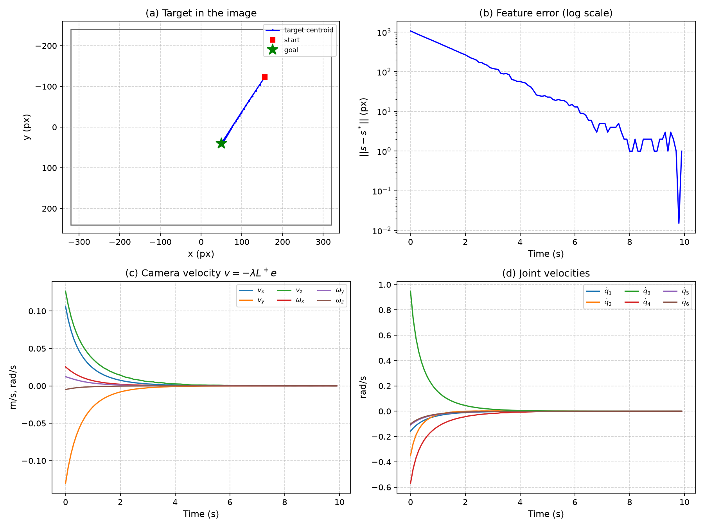
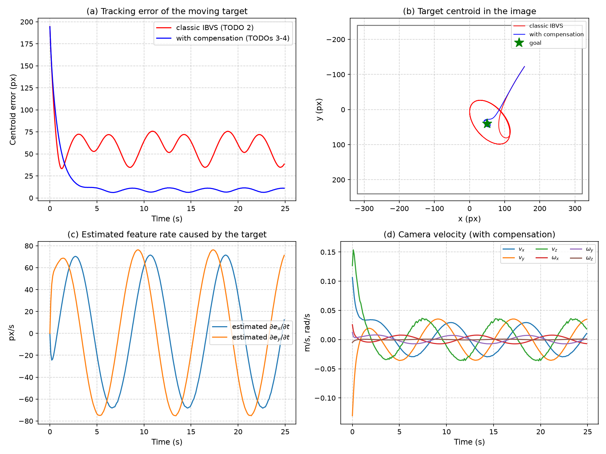
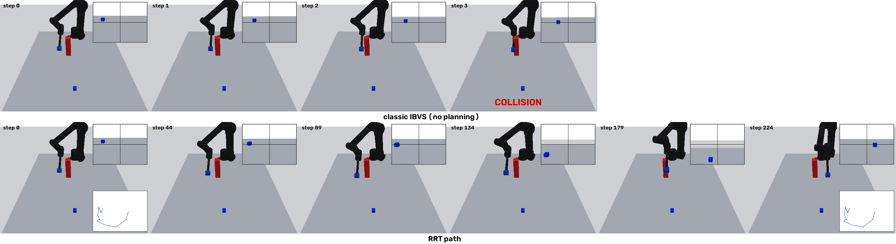
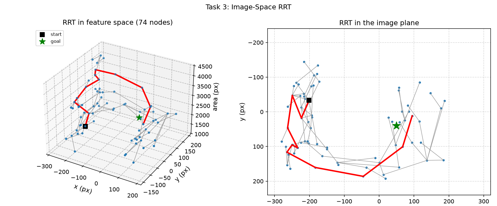
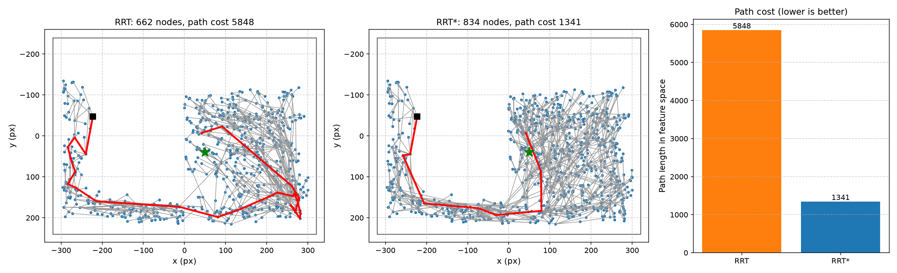

# Assignment 3 Report: Visual Servoing and Image-Space Path Planning with a UR5

This report covers my solution to Assignment 3 (the assignment text is in [README.md](README.md)).
All nine TODOs (0–8) are implemented, all 37 unit tests pass, and all four tasks run to completion.
The figures are the outputs of `python main.py --all --headless`, stored in [results/](results/).

## Summary

| Task | What it shows | My result (s\* = [50, 40, 2500]) |
|:---:|:---|:---|
| 1 | Classic IBVS, static target | error 1068 → 1.0 px in 10 s; below 10 px after 6.2 s |
| 2 | IBVS, moving target | steady tracking error 57.5 px (classic) → 9.1 px (compensated) |
| 3 | Image-space RRT around a pillar | classic IBVS collides after 3 steps; RRT path: 0 collisions, min clearance 3.0 cm |
| 4 | Image-space RRT\* around a wall | path cost 5848 (RRT) → 1341 (RRT\*), 4.4× shorter; 0 collisions |

## 1. Desired feature (TODO 0)

The feature vector is `s = [xc, yc, a]`. The first two entries are the target centroid in pixels from the image
centre, and `a` is its area in px². I chose

```python
GOAL_FEATURE = np.array([50.0, 40.0, 2500.0])
```

This sits in the middle of the recommended ranges (x\* 0–100, y\* 0–80, a\* 2000–3000), so it is reachable in all
four tasks and leaves margin from the edges of the reachable set. I chose it on purpose to differ from the
reference value [0, 0, 3000], so my results are not just a copy of `results_reference/`. The target ends
slightly right of and below the image centre, and a bit farther away than in the reference (smaller area).

## 2. Implementation

### TODO 1: Interaction matrix (`kinematics.py`)

With normalised coordinates `x = xc/fx` and `y = yc/fy` (fx = fy = 500 px), a point at depth Z gives the
classic point-feature rows. For a planar target parallel to the image, the area scales as `a ∝ 1/Z²`, which
gives the third row:

```
L_x = fx · [ -1/Z,    0,  x/Z,   x·y,  -(1+x²),   y ]
L_y = fy · [    0, -1/Z,  y/Z, 1+y²,     -x·y,  -x ]
L_a =      [    0,    0, 2a/Z, 3a·y,    -3a·x,   0 ]
```

Rows 1–2 are multiplied by the focal length because the features are in pixels (`ẋc = fx·ẋ`). Row 3 is
already in px², so it is not scaled. The extra unit test, which compares rows 1–2 against a finite-difference
projection of a 3-D point, passes. That confirms the sign conventions.

### TODO 2: Classic IBVS (`ibvs.py`)

```
v = -λ L⁺ e,   e = s - s*
```

With `L L⁺ ≈ I`, the closed loop is `ė = L v = -λ e`, so every error component decays as `e^(-λt)`.
`L⁺` is the damped pseudo-inverse provided in the code. L is 3×6, so this gives the minimum-norm camera twist
that produces the wanted feature rate.

### TODOs 3–4: Moving target (`ibvs.py`)

When the target moves, the error changes for two reasons: the camera moved (`L v`), and the target moved
(`∂e/∂t`). So `ė = L v + ∂e/∂t`. The target's part cannot be measured directly. It is estimated from the
previous step as "measured change minus what my own motion explains":

```
∂ê/∂t = (s_k - s_{k-1})/Δt - L_{k-1} v_{k-1}            (TODO 3)
v     = -L⁺ (λ e + ∂ê/∂t)                                (TODO 4)
```

Substituting gives `ė = -λ e + (∂e/∂t - ∂ê/∂t)`. The error still converges exponentially, and what is left
comes only from the estimation error. The provided loop low-pass filters the estimate (weight 0.5).

### TODO 5: Image-space RRT extension (`planner.py`)

One extension step from the nearest tree node towards a random sample `s_rand`:

1. Feature velocity towards the sample: `ṡ = λ_RRT (s_rand - s_parent)`, with λ_RRT = 0.5.
2. Image Jacobian `J1 = L(s_parent, z_parent) · Jc(q_parent)`, which maps joint rates to feature rates.
3. Joint velocity from the task-priority solver, `q̇ = J1⁺ ṡ + P1 (J2 P1)⁺ (0 - J2 J1⁺ ṡ)`. The primary task is
   the feature velocity. The secondary task `J2 = Jc[3:]` (angular rows) keeps the camera orientation fixed in
   the null space of the primary task. Then `q̇` is scaled down uniformly to respect joint velocity limits.
4. Integrate: `q_new = q_parent + q̇ Δt`.

The new configuration is then rendered and checked by the provided code for field of view, joint limits,
occlusion, and collisions along the edge. So each feature node in the tree is known to be reachable by the
robot.

### TODO 6: Tree drawing (`visualizer.py`)

Every parent→child edge is drawn as a thin grey line, the nodes as blue dots, and the start-to-goal path as a
thick red line on top. `np.column_stack` gives one row per coordinate, so the same code works for the 2-D
image-plane plot and the 3-D `[x, y, a]` plot.

### TODOs 7–8: RRT\* (`planner.py`)

**Choose parent (TODO 7).** The new node first gets its extension parent as a candidate. Then, for each
neighbour within 150 px, the cost through it is `cost[i] + ‖s_new − s_i‖`. The cheapest candidate wins if the
two configurations are connectable: joint step ≤ 0.5 rad, and the straight joint-space edge is free of
collisions and occlusion and keeps the target in view. The cost comparison runs first, because the
connectivity check is expensive (it renders and collision-checks the whole edge).

**Rewire (TODO 8).** For every neighbour `j` other than the new node's own parent, if
`cost[new] + ‖s_j − s_new‖ < cost[j]` and the edge is connectable, `j` is re-attached to the new node. The
parent is changed in both the feature tree and the configuration tree, so they stay consistent. The cost
change is then pushed to `j` and its whole subtree. A cycle cannot form: an ancestor of the new node always
has a lower cost than the new node, so the rewire test can never succeed for it.

## 3. Results

### Task 1: IBVS, static target



- Error ‖s − s\*‖: 1068 → 1.0 px in 100 steps (10 s). Final feature [50.0, 39.99, 2499] against s\* = [50, 40, 2500].
- On the log-scale plot (b), the error falls along a straight line, which means it decays exponentially as
  expected from `ė = -λe` with λ = 1 s⁻¹. It drops below 10 px after 6.2 s. Below ~2 px the curve becomes
  noisy because the area is measured from a pixel mask and changes in whole pixels.
- The centroid moves on an almost straight line in the image (a), which is typical of IBVS. The camera
  velocities (c) and joint velocities (d) decay smoothly to zero.

### Task 2: IBVS, moving target



| | Mean steady error | Max steady error |
|:---|---:|---:|
| Classic IBVS (TODO 2) | 57.5 px | 75.7 px |
| Compensated (TODOs 3–4) | 9.1 px | 11.4 px |

- **Why classic IBVS lags.** At steady state, classic IBVS needs a non-zero error to produce any camera motion
  (`v ∝ e`). To follow a target moving at feature speed ṡ_t, it settles at `e ≈ ṡ_t / λ`. Plot (c) shows the
  estimated target-induced rate reaching about 70–75 px/s. With λ = 1 this predicts a lag of about 70 px,
  which matches the measured 57.5 px mean and 75.7 px maximum. In plot (b) the classic trajectory (red)
  circles around the goal instead of reaching it.
- **Why compensation helps.** The feed-forward term cancels most of the target motion, so the error drops
  about 6×. The remaining ~9 px comes from delay in the estimate: it uses the previous step's data and is
  low-pass filtered. That adds roughly 0.1–0.15 s of lag, and at ~70 px/s this explains about 10 px.
- The estimated `∂ê/∂t` (c) is a clean pair of sinusoids, 90° apart, with an 8 s period. That is exactly the
  signature of a target moving on a circle, so the estimator works as intended.

### Task 3: Image-space RRT (pillar)





- **Classic IBVS fails.** It drives straight towards the goal and the arm hits the pillar after 3 steps (top
  row). IBVS only minimises image error and knows nothing about the robot's body in 3-D.
- **Planning then tracking.** The RRT reached the goal region after 280 iterations, with 74 nodes and a path
  cost of 3283. The path was resampled to 225 waypoints (≤ 15 px apart) and tracked with trajectory-tracking
  IBVS in 22.5 s.
- Collisions: **0**. Minimum robot–obstacle clearance: **2.98 cm**, above the 2 cm safety margin.
- Final error 58 px. The planner stops at the first node within the goal radius R = 75 px. The final planned
  node [94.7, 11.6, 2468] is 62 px from s\*, so this residual is a result of the planner's goal radius, not a
  tracking failure.

### Task 4: Image-space RRT\* (wall)



| | RRT | RRT\* |
|:---|---:|---:|
| Path cost (feature space) | 5848 | **1341** |
| Tree nodes | 662 | 834 |
| Planning time | 26.1 s | 55.7 s |
| Waypoints after resampling | 406 | 94 |

- RRT\* gives a path **4.4× shorter** than RRT in the same environment. The RRT path takes a long detour into
  the right part of the image and back. Choose-parent and rewiring straighten the RRT\* path into a clean
  "U" around the wall.
- The cost is planning time. RRT\* runs all 3000 iterations instead of stopping at the first solution, and it
  does extra connectivity checks, so it takes about 2× longer.
- Execution of the RRT\* path: 94 control steps (9.4 s), **0 collisions**, minimum clearance 2.25 cm.
- Final error 110.7 px. The planned end node [41.2, −7.2, 2487] is about 50 px from s\*, inside the goal radius.
  The executed final feature was [37.4, −17.0, 2406]. Most of the remaining error is area (−94 px²) and y
  (−57 px), added while tracking the short final segment. Note that ‖s − s\*‖ mixes px and px², so 94 px² of
  area error is only about a 4% difference in target size. A smaller goal radius, or a short classic-IBVS
  phase after the path ends, would reduce this residual.

## 4. Verification

- `python -m unittest tests.test_framework tests.test_task1 tests.test_task2 tests.test_task3 tests.test_task4`
  runs 37 tests, all OK.
- The unit tests use the reference goal [0, 0, 3000]. With it, my RRT and RRT\* produce path costs of
  **6156 and 1862**, exactly the values in `results_reference/`. This confirms TODOs 5, 7 and 8 match the
  intended algorithm.

## 5. Reproduction

```bash
python -m venv .venv
.venv\Scripts\activate            # Linux/macOS: source .venv/bin/activate
pip install numpy
pip install -r requirements.txt
python -m unittest tests.test_task1 tests.test_task2 tests.test_task3 tests.test_task4 -v
python main.py --all --headless   # writes results/ and results/summary.md
```

Note: when pybullet has to be compiled from source (as on my Windows setup), NumPy must be installed **before**
pybullet. Otherwise pybullet is built without NumPy support and camera images come back as flat lists. The
symptom is `IndexError: too many indices for array` in `simulation.py`. The fix is
`pip install --force-reinstall --no-deps --no-build-isolation pybullet` after NumPy is present.
